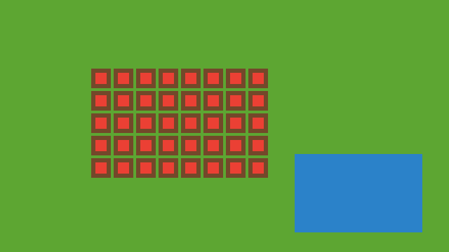

<p align="center">
  
</p>

<h1 align="center">🌠 Thung Lũng Sao Băng — Huyền Thoại Cây Đại Thụ</h1>

<p align="center">
  
  
  
  
</p>

Game nông trại **Pixel Art** pha trộn RPG — canh tác, chăn nuôi, câu cá, rèn Thần Khí `+20`, đánh Boss, leo Tháp vô tận và Luân Hồi Thăng Hoa. Toàn bộ chạy trong trình duyệt bằng JavaScript thuần, **không framework, không build step, không phụ thuộc bên ngoài**.

---

## ✨ Tính Năng Chính

### 🗺️ 5 Thế Giới Đa Không Gian (5 Realms)
Mở khóa tuần tự theo Cấp độ / Cấp Thần Khí / Tầng Tháp / Luân Hồi — cây trồng và xưởng sinh trưởng song song trên cả 5 bản đồ:

| Bản đồ | Điều kiện mở khóa | Đặc trưng |
| :--- | :--- | :--- |
| 🏡 **Thung Lũng Khởi Nguyên** | Mở sẵn | Nông trại 4 mùa, Biệt Thự Hoàng Kim, Đền Đại Thụ, 6 Xưởng Tự Động (+G/s), Hồ Cá Koi |
| ⛏️ **Động Pha Lê Cổ Đại** | Cấp 2 (hoặc thu hoạch 4 cây / 200G) | Đất tự ẩm, lớn nhanh ×1.35, mỏ Đá Cường Hóa / Bảo Thạch / Vàng tự mọc lại |
| 🌌 **Đảo Thiên Không Ngân Hà** | Cấp 4 (hoặc Thần Khí +3 / 600G) | Lớn nhanh ×2.0, đột biến ×3.0, Tháp Tinh Tú & Đài Luân Hồi |
| 🔥 **Thánh Địa Thần Long Hoả Diệm** | Cấp 6 (hoặc Thần Khí +6 / Luân Hồi ★1) | Lớn nhanh ×2.8, đột biến ×4.0, **nhân đôi sản lượng**, Mỏ Hỏa Ngọc |
| 🪐 **Vương Quốc Tinh Tú Vô Cực** | Cấp 8 (hoặc Thần Khí +10 / Tháp Tầng 3 / Luân Hồi ★2) | Lớn siêu tốc ×3.8, đột biến ×5.0, **nhân ba sản lượng**, Mỏ Thiên Thạch & **👾 Boss Kỳ Lân Tinh Vân** |

### 🌾 Canh tác & Kinh tế
- **14 giống cây trồng** dựng bằng Pixel Art 16×16 qua **5 giai đoạn sinh trưởng** (Stage 0→4), trong đó có **4 Siêu Giống Lai Tạo**: ⏳ Hoa Hồng Thời Gian, 🐦‍🔥 Hoa Phượng Hoàng Lửa, 🪐 Quả Thế Giới Vũ Trụ, 👑 Trái Sáng Thế Yggdrasil.
- **Giữ & Kéo chuột quét liên hoàn**: cuốc, gieo, tưới, thu hoạch cả hàng ô chỉ bằng một lượt lướt.
- **Khung ngắm 3×3 trực quan** cho Vòi Tưới, Đèn Lồng Đom Đóm, Cuốc/Bình Tưới 3×3.
- Chăn nuôi (Gà, Bò, Ong), câu cá Chép Koi minigame, 9 công thức nấu ăn, 6 Xưởng Tự Động sinh Vàng/giây.
- Bách Khoa Toàn Thư theo dõi tiến độ sưu tầm + **Nhật Ký Tổng Kết Cuối Ngày** (thu nhập, sản lượng, dự báo thời tiết).

### 🔨 Lò Rèn Thần Khí (Feel game RPG trọn vẹn)
- **Cường hóa `+0 → +20`** với Thanh Chúc Phúc Pity 100% — trượt không bao giờ tụt cấp.
- **Thức Tỉnh `★1 → ★5`**, Tẩy Luyện Phụ Ma (Hiếm → Thái Cổ ★★), Khảm 3 Ô Ngọc & Hợp Nhất Ngọc `3 ➔ 1` (4 bậc).
- **Cộng Hưởng Bộ 4 Thần Khí** (`+4 → +60`) kích hoạt hào quang, ngọc xoay quanh người và Đôi Cánh Ánh Sao.
- **👾 Boss Kỳ Lân Tinh Vân** (`Lv.1 → ∞`), **🗼 Tháp Tinh Tú vô tận** (`Tầng 1 → ∞`), **🌌 Đài Luân Hồi Thăng Hoa** (`★1 → ∞`).
- **15 Chương Cốt Truyện** với các NPC: Tinh Linh Lumia, Bà Mai, Bác Tâm, Cô Linh, Lão Ngư Kiên.

## 🚀 Chạy Game

Không cần cài đặt gì. Chọn một trong hai cách:

```bash
# Cách 1: Mở trực tiếp
Mở file index.html bằng trình duyệt (Chrome / Edge / Firefox).

# Cách 2: Chạy qua server tĩnh (khuyến nghị)
python3 -m http.server 8000
# hoặc: npx serve .
# → truy cập http://localhost:8000
```

## 🎮 Điều Khiển

| Nút | Chức năng |
| :--- | :--- |
| `W A S D` / Phím mũi tên | Di chuyển nhân vật |
| `1` – `8` | Chọn công cụ: 1-Chạm thông minh, Cuốc, Bình tưới, Hạt giống, Liềm, Vòi 3×3, Đèn lồng, Cần câu |
| **Giữ chuột trái & kéo** | Thao tác liên hoàn trên nhiều ô đất |
| `Space` | Tương tác ô đang đứng / Kéo cần khi cá cắn |
| `Q` | Mở Đế Chế (nhiệm vụ) |
| `E` | Mở Lò Rèn & Chợ |
| `Esc` | Đóng bảng đang mở |

Trên **mobile**: thanh điều hướng 5 tab vùng ngón cái + chế độ **✨ 1-Chạm** tự động cuốc/gieo/tưới/thu hoạch.

## 💾 Lưu Game

- Tự động lưu vào `localStorage` (`starlight_valley_save_v11`).
- Xuất file bản lưu `.json` về máy trong tab `📖 Cẩm Nang`.
- Bộ chuyển đổi `applySavePayload()` tự nâng cấp dữ liệu cũ từ **v4 → v11** mà không mất tiến trình.

## 📁 Cấu Trúc Dự Án

```
├── index.html              # Khung giao diện: HUD 2 hàng, canvas, modal, điều khiển mobile
├── css/
│   └── style.css           # Giao diện pixel-art, responsive desktop/mobile
├── js/
│   ├── config.js           # Cấu hình game: 5 Realms, 14 cây, đồ, NPC, công thức
│   ├── main.js             # Vòng lặp game, tương tác, luân hồi, boss, tháp
│   ├── world.js            # Bản đồ, ô đất, mỏ quặng, sinh trưởng cây
│   ├── entities.js         # Nhân vật, vật nuôi, sprite động
│   ├── sprites.js          # Vẽ pixel art thủ tục (nhân vật, cây, hiệu ứng)
│   ├── ui.js               # Modal, cửa hàng, lò rèn, bách khoa, tổng kết ngày
│   ├── pixel_icons.js      # Icon pixel 16×16 cho hotbar & kho đồ
│   └── audio.js            # Nhạc nền & SFX Web Audio
├── assets/                 # Tileset, nhân vật, cây, icon, chân dung NPC, banner
└── UI_UX_Improvements.md   # Báo cáo thiết kế tâm lý hành vi v11.0
```

## 🛠️ Công Nghệ

- **JavaScript thuần (ES6+)** — không framework, không thư viện ngoài.
- **Canvas 2D** với `image-rendering: pixelated` cho đồ họa pixel sắc nét.
- **Web Audio API** tổng hợp nhạc nền & hiệu ứng âm thanh lúc chạy.
- **localStorage + JSON** cho hệ thống lưu/migration.
- ~10.000 dòng code, tổng dung lượng vài trăm KB — tải phát chơi ngay.

---

<p align="center">
  🌠 Made with ❤️ by <a href="https://github.com/manhquydev">manhquydev</a>
</p>
